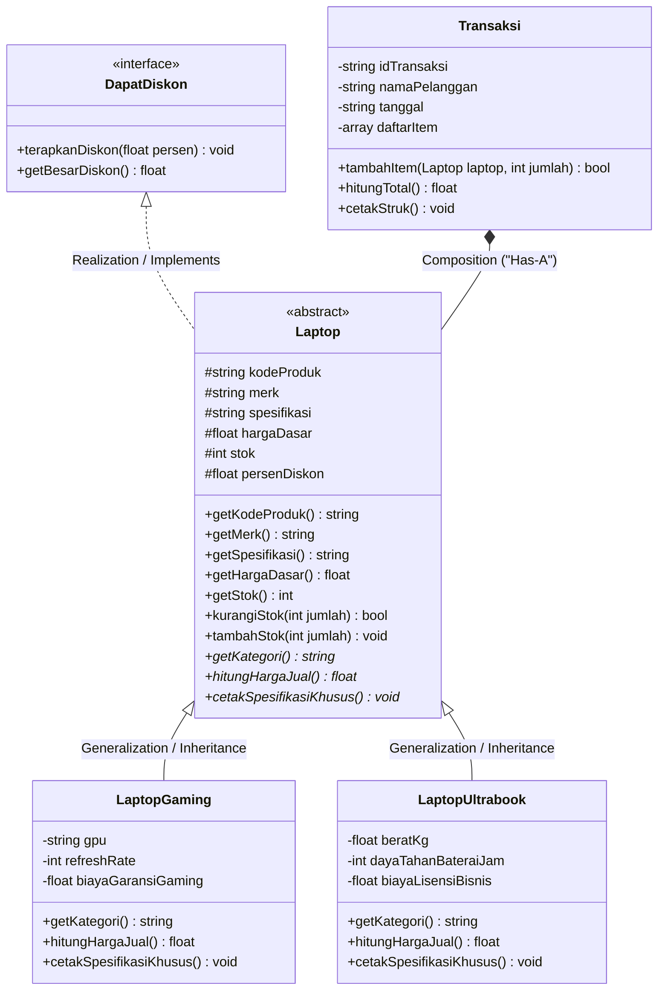
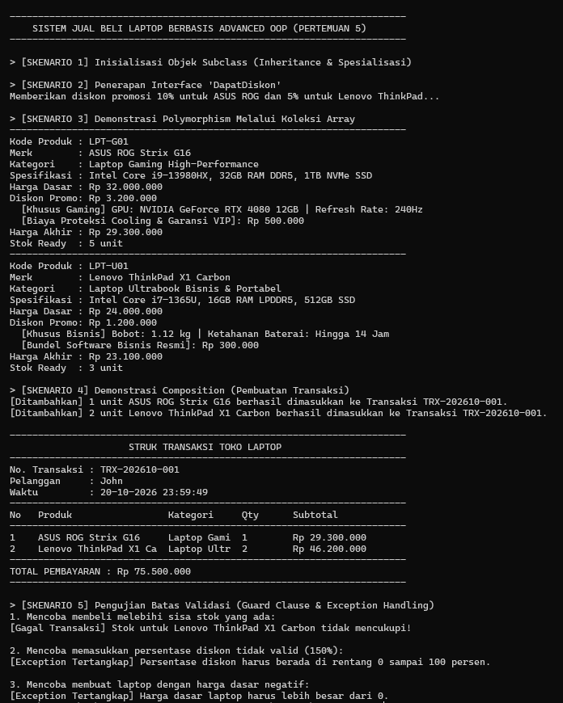
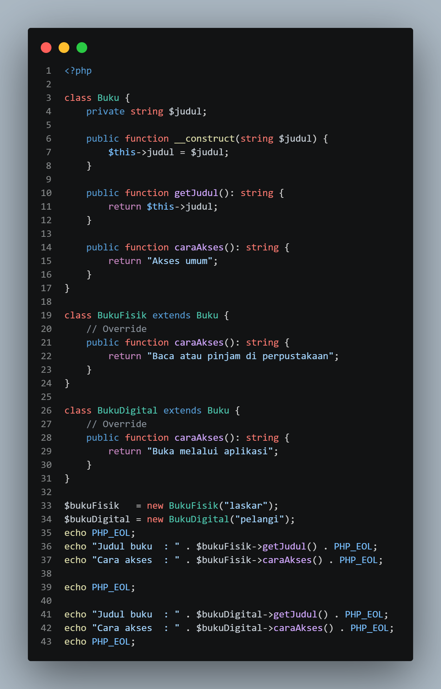
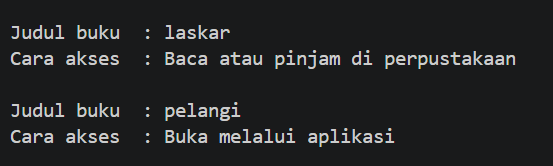
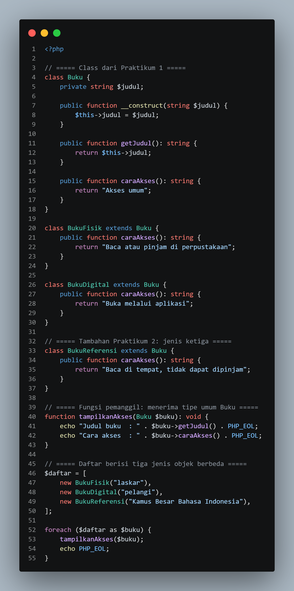
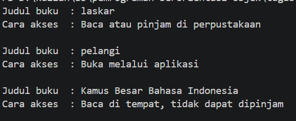
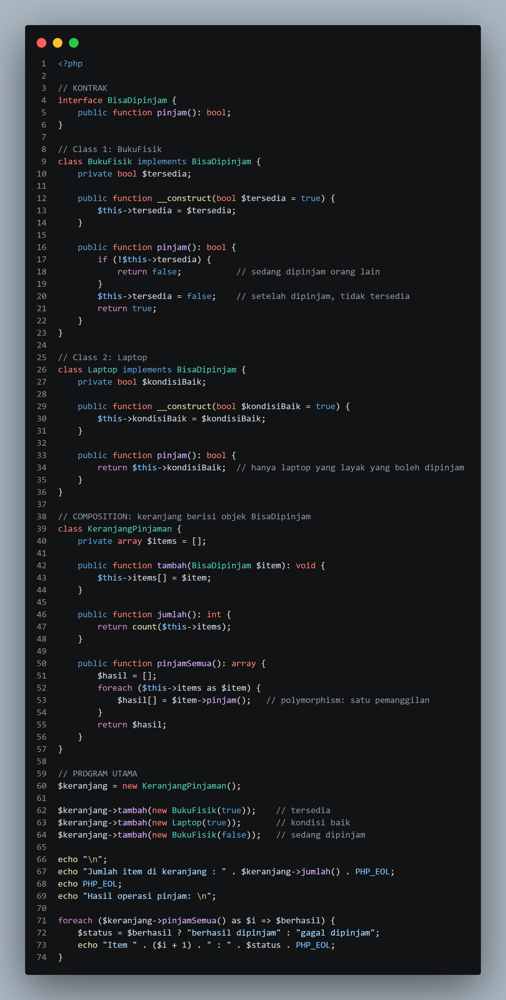
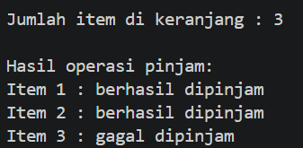

# Mini Application OOP: Sistem Jual Beli Laptop
> **Tugas Praktikum Pertemuan 5 — Advanced Object-Oriented Programming (PBO)**  
> Program Studi Teknik Informatika, Fakultas Sains dan Teknologi  
> Universitas Catur Insan Cendekia (UCIC)


## Deskripsi Kasus & Domain Model
Proyek ini mengimplementasikan konsep **Advanced OOP** pada domain **Sistem Jual Beli Laptop**. Sistem ini dirancang untuk mengelola inventaris berbagai kategori laptop, perhitungan harga dinamis dengan promosi diskon, serta pemrosesan transaksi belanja menggunakan relasi antarkelas yang modular, fleksibel, dan terukur.

---

## Diagram Hubungan Kelas (UML Class Diagram)



---


### 1. Domain dan Kandidat Class
Domain yang dipilih adalah **Sistem Jual Beli Laptop (Toko Komputer Digital)** dengan 4 kandidat class utama:
1. `Laptop` *(Abstract Class)*: Blueprint dasar yang merepresentasikan seluruh produk laptop.
2. `LaptopGaming` *(Subclass)*: Spesialisasi laptop gaming berkinerja grafis tinggi.
3. `LaptopUltrabook` *(Subclass)*: Spesialisasi laptop tipis berorientasi portabilitas dan bisnis.
4. `Transaksi` *(Class Komposisi)*: Entitas pencatat bukti pembelian yang menampung kumpulan laptop.
5. `DapatDiskon` *(Interface)*: Kontrak kemampuan pemberian diskon promosi.

### 2. Penentuan Relasi Objek
- **Inheritance (*"Is-A"*)**:
  `LaptopGaming` dan `LaptopUltrabook` mewarisi `Laptop`. Keduanya berbagi atribut umum seperti merk, spesifikasi, harga dasar, dan stok tanpa duplikasi kode.
- **Interface (*"Can-Do"*)**:
  `Laptop` mengimplementasikan `interface DapatDiskon`. Ini menetapkan kontrak bahwa semua turunan laptop memiliki kemampuan menerima potongan harga promosi.
- **Composition (*"Has-A"*)**:
  Class `Transaksi` memiliki relasi komposisi dengan `Laptop` (`array $daftarItem`). Suatu transaksi tidak dapat menghitung totalnya tanpa keberadaan item-item objek laptop di dalamnya.

### 3. Implementasi Abstract Class dan Interface
- **Abstract Class `Laptop`**:
  Memiliki metode konkrit (enkapsulasi getter dan manajemen stok) sekaligus *abstract method* (`hitungHargaJual()`, `getKategori()`, `cetakSpesifikasiKhusus()`) yang mewajibkan subclass menyediakan logika spesifik.
- **Interface `DapatDiskon`**:
  Memisahkan antara kontrak *apa yang bisa dilakukan* (`terapkanDiskon`) dengan rincian *bagaimana rumusnya dihitung*.

### 4. Overriding dan Polymorphism
- **Method Overriding**:
  - `LaptopGaming::hitungHargaJual()`: Menghitung harga dasar dikurangi diskon, ditambah biaya garansi pendingin liquid cooling VIP.
  - `LaptopUltrabook::hitungHargaJual()`: Menghitung harga dasar dikurangi diskon, ditambah lisensi software bisnis resmi.
- **Polymorphism**:
  - Pada fungsi `tampilkanKatalogPolymorphic(Laptop $laptop)` dan pada method `Transaksi::hitungTotal()`, kode pemanggil hanya berinteraksi dengan tipe umum `Laptop`. Pemanggilan method `hitungHargaJual()` secara dinamis mengeksekusi rumus subclass masing-masing tanpa satu pun percabangan `if/else`.

### 5. Bukti Eksekusi Program
Program diuji menggunakan PHP 8.3 CLI (Laragon Environment) dan menghasilkan output:
- Inisialisasi objek subclass.
- Pengaplikasian diskon 10% dan 5%.
- Tampilan katalog produk secara seragam (Polymorphism).
- Pencetakan struk transaksi lengkap dengan kalkulasi subtotal dan total (Composition).
- Uji validasi batas (stok tidak cukup, diskon tidak valid, dan harga negatif ditolak dengan aman).

#### Screenshot Hasil Eksekusi:


### 6. Alasan Pemilihan Relasi & Desain (Dokumentasi / Refleksi)
1. **Mengapa Inheritance?**
   Laptop Gaming dan Ultrabook memiliki kesamaan sifat mendasar (*state*) seperti merk, harga, dan stok. Menggunakan inheritance menghindari duplikasi kode (*DRY*) dan memusatkan validasi data dasar pada satu tempat (constructor parent).
2. **Mengapa Interface?**
   Tidak semua produk di masa depan harus merupakan turunan class `Laptop`. Aksesoris lain (seperti mouse, keyboard, monitor) nantinya juga bisa dikenai diskon cukup dengan mengimplementasikan `DapatDiskon` tanpa terikat hierarki pewarisan `Laptop`.
3. **Mengapa Composition pada Transaksi?**
   Transaksi bukanlah sebuah laptop (*is-not-a laptop*), melainkan transaksi *memiliki* laptop (*has-a laptop*). Pola komposisi memberikan fleksibilitas di mana sebuah struk transaksi dapat menampung berbagai varian laptop dalam jumlah dinamis.

---

## Struktur File Proyek
```text
tugas-minggu-5/
├── main.php                                   # Source Code Utama Mini Application OOP
├── README.md                                  # Dokumentasi Lengkap Repositori GitHub
├── output-mini-project.png                    # Bukti Screenshot Eksekusi Terminal
├── praktikum1.php                             # Hasil Praktikum 1 (Inheritance & Overriding)
├── praktikum2.php                             # Hasil Praktikum 2 (Polymorphism)
├── praktikum3.php                             # Hasil Praktikum 3 (Interface & Composition)
└── docs/                                      # Folder Pendukung Screenshot Praktikum
```

---

## Cara Menjalankan Program

Pastikan PHP versi 8.0 ke atas telah terpasang di komputer Anda (atau gunakan terminal Laragon / VSCode).

```bash
# Masuk ke direktori tugas
cd tugas-minggu-5

# Jalankan program utama
php main.php
```

---

## Dokumentasi Praktikum

| Praktikum | Kode Program | Output Terminal |
| :--- | :---: | :---: |
| **Praktikum 1**<br>*(Inheritance & Overriding)* |  |  |
| **Praktikum 2**<br>*(Polymorphism)* |  |  |
| **Praktikum 3**<br>*(Interface & Composition)* |  |  |

---
*Dibuat dengan dedikasi akademik untuk memenuhi penugasan PBO Pertemuan 5 — Universitas Catur Insan Cendekia.*
